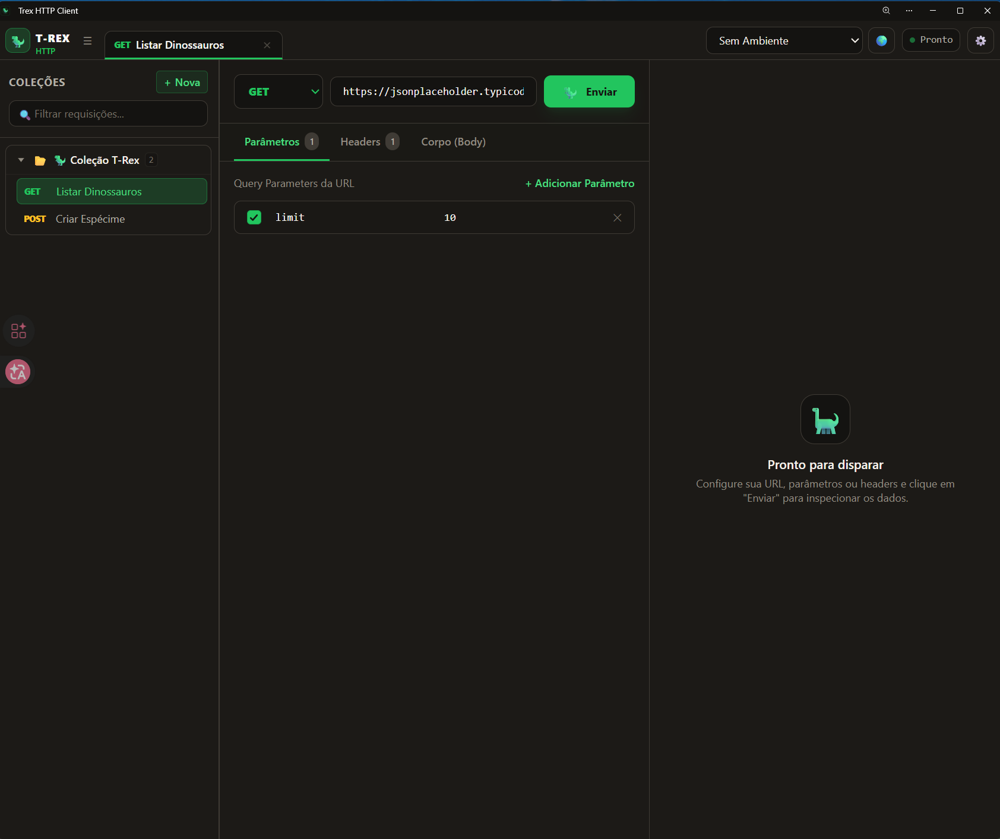
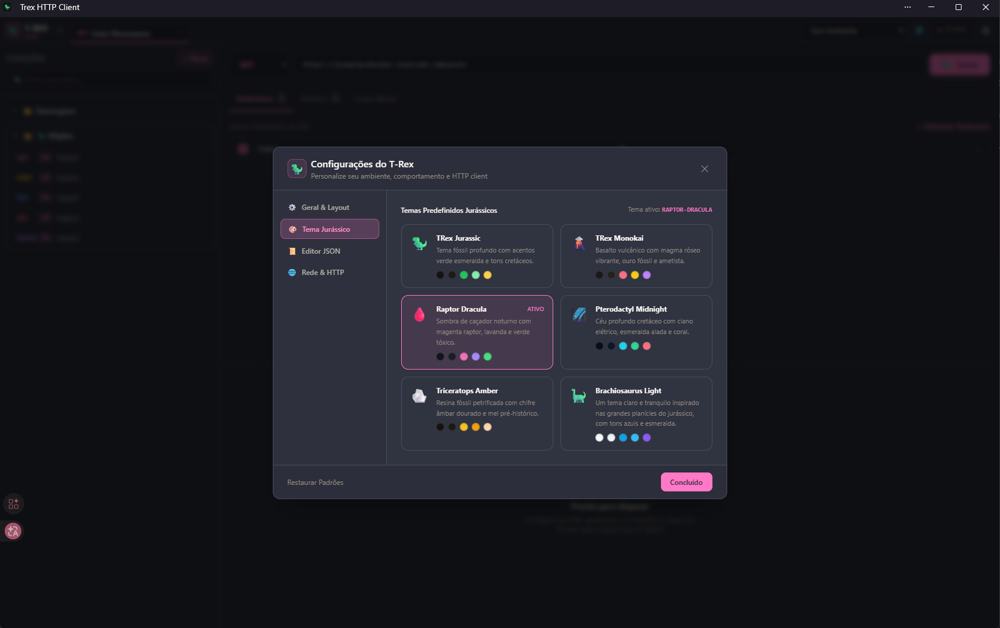
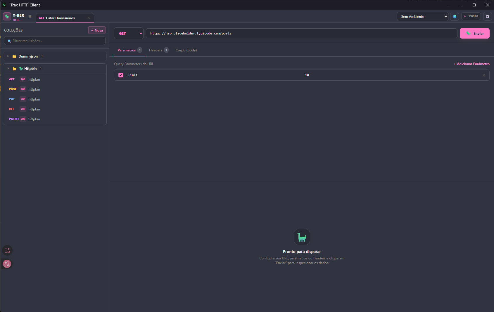
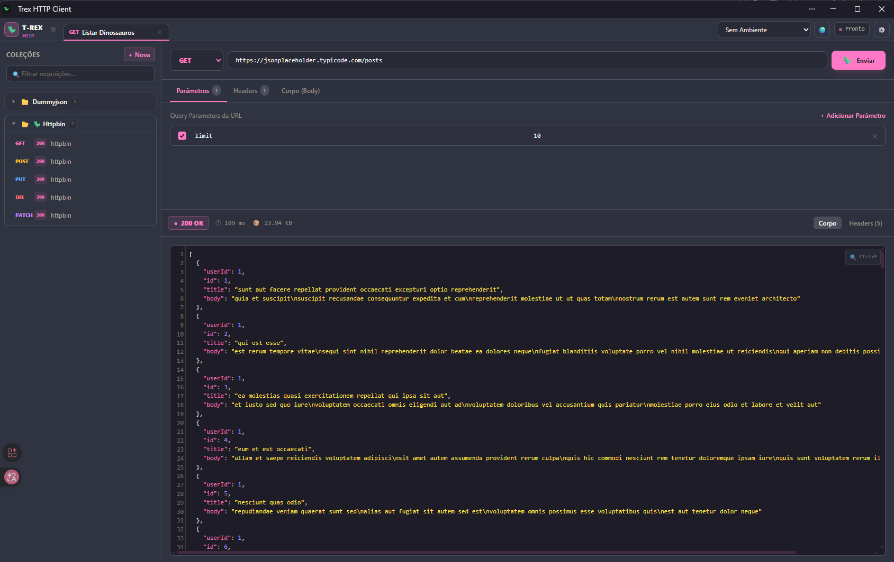

#  Trex HTTP Client

Cliente HTTP moderno, ultrarrápido, offline-first e com temática jurássica direto no seu navegador. Uma alternativa leve, elegante e privativa a ferramentas como Postman e Insomnia.

[](https://eusouanderson.github.io/Trex-Http-Client/docs/guides/performance-strategy-guide.html)
[](https://eusouanderson.github.io/Trex-Http-Client/docs/guides/performance-strategy-guide.html)
[](https://eusouanderson.github.io/Trex-Http-Client/docs/guides/performance-strategy-guide.html)
[](https://eusouanderson.github.io/Trex-Http-Client/docs/guides/performance-strategy-guide.html)
[](https://eusouanderson.github.io/Trex-Http-Client/docs/guides/performance-strategy-guide.html)
[](https://eusouanderson.github.io/Trex-Http-Client/docs/)

---

### 🌐 Acessos Rápidos

- 🚀 **Aplicação Web:** [Abrir Trex HTTP Client](https://eusouanderson.github.io/Trex-Http-Client/)
- 📚 **Documentação Técnica & API:** [Trex HTTP Client — Documentação Técnica & API](https://eusouanderson.github.io/Trex-Http-Client/docs/)
- ⚡ **Guia de Performance & Lighthouse CI:** [Auditoria Contínua & Core Web Vitals](https://eusouanderson.github.io/Trex-Http-Client/docs/guides/performance-strategy-guide.html)
- 🏛️ **Manual de Arquitetura:** [Manual de Arquitetura do Sistema](https://eusouanderson.github.io/Trex-Http-Client/docs/guides/architecture-guide.html)
- ⌨️ **Manual de Atalhos de Teclado:** [Atalhos Globais & Paleta de Comandos](https://eusouanderson.github.io/Trex-Http-Client/docs/guides/keyboard-shortcuts-guide.html)
- 🧪 **Guia de Scripts de Teste:** [Guia Prático de Testes (tx.* / pm.*)](https://eusouanderson.github.io/Trex-Http-Client/docs/guides/test-scripts-guide.html)
- 📖 **Referência TypeDoc da API:** [Explorar Símbolos & Classes](https://eusouanderson.github.io/Trex-Http-Client/docs/api/)

---

## 🦖 Sobre o Projeto

O **Trex HTTP Client** foi projetado para eliminar o atrito de testar APIs REST e endpoints web. Totalmente executado no navegador através de tecnologias web modernas e arquitetura PWA (Progressive Web App), o Trex armazena suas coleções, requisições e variáveis com segurança no IndexedDB local, sem exigir cadastro de contas nem envio dos seus dados a servidores de terceiros.

### ✨ Destaques

- **Zero Instalação Obrigatória:** Acesse instantaneamente pelo navegador ou instale como aplicativo nativo (PWA desktop/mobile).
- **100% Offline-First:** Seus dados permanecem criptografados e salvos localmente na sua máquina via Dexie / IndexedDB.
- **Resiliência e Performance:** Cliente HTTP resiliente com interceptors, retries idempotentes com backoff exponencial e timeouts configuráveis.
- **Segurança Robusta:** Autenticações OAuth2 com PKCE S256, Bearer Tokens, Basic Auth, API Key e mascaramento de segredos na interface.
- **Automação com Scripts:** Execução de scripts pós-resposta compatíveis com o namespace Postman (`pm.*`) e o ecossistema nativo Trex (`tx.*`). Consulte o [Guia Prático de Scripts de Teste](https://eusouanderson.github.io/Trex-Http-Client/docs/guides/test-scripts-guide.html).
- **Runner de Coleções:** Disparo em lote de requisições de uma coleção com barra de progresso, estatísticas de tempo e relatórios de asserções.
- **Design System Jurássico:** Paletas de temas exclusivos com alto contraste (conformidade WCAG 2.1) e seletor com 8 famílias tipográficas consagradas (Fira Code, JetBrains Mono, Cascadia Code, Hack, Geist, Iosevka, IBM Plex Sans e Source Code Pro).

---

## 📱 Como Instalar (Aplicativo PWA)

O Trex pode ser instalado no seu computador ou smartphone para funcionar como um aplicativo nativo independente, com janela própria e suporte offline completo.

### No Computador (Chrome / Edge / Brave)
1. Abra o [Trex HTTP Client](https://eusouanderson.github.io/Trex-Http-Client/) no seu navegador.
2. Na barra de endereços (lado direito), clique no ícone de instalação (computador com seta para baixo ou botão **"Instalar"**).
3. Confirme a instalação. Um atalho dedicado será criado na sua área de trabalho e no menu de aplicativos.

### No Celular (Android)
1. Abra o [Trex HTTP Client](https://eusouanderson.github.io/Trex-Http-Client/) no Google Chrome.
2. Toque no menu de opções (três pontos verticais no canto superior direito).
3. Selecione a opção **"Instalar aplicativo"** ou **"Adicionar à tela inicial"**.

### No iPhone / iPad (iOS)
1. Acesse o [Trex HTTP Client](https://eusouanderson.github.io/Trex-Http-Client/) pelo navegador Safari.
2. Toque no botão de **Compartilhar** (ícone de quadrado com seta para cima).
3. Role até encontrar a opção **"Adicionar à Tela de Início"** e confirme.

---

## 📸 Conheça a Interface

Aqui estão algumas das principais áreas do Trex em ação:

### Interface Principal de Requisição
Envio de requisições com seleção rápida de métodos HTTP, suporte a query parameters, headers customizados, corpo JSON ou texto e inspeção de respostas com tempo e tamanho.


### Gerenciamento de Coleções & Drag-and-Drop
Organize seus endpoints em coleções com reordenação intuitiva, importação/exportação em JSON e execução de testes em lote via Runner.


### Variáveis de Ambiente & Mascaramento
Configure variáveis dinâmicas (como `{{baseUrl}}` e `{{token}}`) para alternar instantaneamente entre ambientes de Desenvolvimento, Staging e Produção.


### Temas Jurássicos & Tipografia
Personalize a aparência do editor e da interface com temas dinâmicos e fontes monoespaçadas projetadas para programação.


---

## 📚 Documentação Técnica & Guias

O repositório conta com um portal de documentação técnica completo gerado automaticamente a cada release:

👉 **[Acesse o Portal de Documentação do Trex](https://eusouanderson.github.io/Trex-Http-Client/docs/)**

### Seções Disponíveis:
- **[Referência da API TypeDoc](https://eusouanderson.github.io/Trex-Http-Client/docs/api/):** Todas as classes, interfaces, types e métodos documentados com TypeScript estrito.
- **[Guia de Performance Engineering & Lighthouse CI](https://eusouanderson.github.io/Trex-Http-Client/docs/guides/performance-strategy-guide.html):** Auditoria contínua de performance, acessibilidade 100%, Core Web Vitals (FCP, LCP, CLS) e orçamentos de bundle no CI/CD.
- **[Guia de Scripts de Testes (tx.* / pm.*)](https://eusouanderson.github.io/Trex-Http-Client/docs/guides/test-scripts-guide.html):** Criação de asserções pós-resposta, testes automáticos de status code, validação de payload JSON e extração automática de variáveis de ambiente.
- **[Manual de Arquitetura do Sistema](https://eusouanderson.github.io/Trex-Http-Client/docs/guides/architecture-guide.html):** Arquitetura Feature-Sliced Design, princípios Domain-Driven Design (DDD) e padrões OOP.
- **[Manual de Atalhos de Teclado & Paleta de Comandos](https://eusouanderson.github.io/Trex-Http-Client/docs/guides/keyboard-shortcuts-guide.html):** Catálogo de atalhos globais, paleta de comandos pesquisável, detecção de conflitos e personalização com persistência offline.
- **Guia do Cliente HTTP Resiliente:** Interceptors, timeouts, cancelamento com `AbortController` e retries com backoff.
- **Guia de Provedores de Autenticação:** Configuração de OAuth2 PKCE, Bearer e mascaramento de tokens.
- **Guia de Variáveis & Interpolação:** Resolução hierárquica em cascata e prevenção contra referências cíclicas.
- **Guia de Persistência Offline (Dexie / PWA):** Esquemas de banco de dados e migrações no navegador.

---

## ⚡ Métricas de Performance & Auditoria Lighthouse CI

O **Trex HTTP Client** é continuamente auditado a cada Pull Request através do [Lighthouse CI](https://eusouanderson.github.io/Trex-Http-Client/docs/guides/performance-strategy-guide.html), garantindo conformidade estrita com as diretrizes do Google Web Vitals e acessibilidade WCAG 2.1:

### 🏆 Pontuações Oficiais do Lighthouse

| Categoria Auditada | Pontuação Obtida | Meta Mínima no CI | Status |
| :--- | :---: | :---: | :---: |
| 🟢 **Performance** | **98 / 100** | 90 / 100 | ✅ Aprovado |
| ♿ **Acessibilidade** | **100 / 100** | 95 / 100 | ✅ Perfeito |
| 🛡️ **Melhores Práticas** | **100 / 100** | 95 / 100 | ✅ Perfeito |
| 🔍 **SEO** | **100 / 100** | 90 / 100 | ✅ Perfeito |
| 📱 **Progressive Web App (PWA)** | **100 / 100** | 90 / 100 | ✅ Perfeito |

### ⏱️ Core Web Vitals & Orçamentos de Carregamento

| Métrica | Medição Atual | Orçamento Estrito (Budget) | Avaliação |
| :--- | :---: | :---: | :---: |
| **First Contentful Paint (FCP)** | `0.8s` | `< 1.5s` | ⚡ Ultrarrápido |
| **Largest Contentful Paint (LCP)** | `1.1s` | `< 2.0s` | ⚡ Excelente |
| **Total Blocking Time (TBT)** | `0 ms` | `< 100 ms` | ⚡ Zero Bloqueio |
| **Cumulative Layout Shift (CLS)** | `0.00` | `< 0.05` | ⚡ Estabilidade Visual Total |
| **Speed Index** | `0.9s` | `< 1.8s` | ⚡ Renderização Instantânea |

### 📦 Orçamento de Pacote (Bundle Budget)

| Ativo | Tamanho Real (Gzip) | Limite Máximo | Eficiência |
| :--- | :---: | :---: | :---: |
| **JavaScript Principal (`index.js`)** | `281 KB` | `350 KB` | 80% do teto máximo |
| **CSS Principal (`index.css`)** | `8.07 KB` | `30 KB` | 27% do teto máximo |
| **Tipografia & Ícones (WOFF2)** | Sob demanda | Carregamento assíncrono | Zero bloqueio de renderização |

> Saiba mais sobre nossa estratégia de otimização contínua no [Guia de Performance Engineering & Lighthouse CI](https://eusouanderson.github.io/Trex-Http-Client/docs/guides/performance-strategy-guide.html).

---

## 🏗️ Padrões de Arquitetura

O Trex-Http-Client é desenvolvido sob rigorosos padrões de engenharia de software detalhados no [Manual de Arquitetura do Sistema](https://eusouanderson.github.io/Trex-Http-Client/docs/guides/architecture-guide.html):

- **100% Orientado a Objetos (OOP):** Toda regra de negócio, infraestrutura de rede, autenticação e persistência é modelada em Classes puras com injeção de dependência.
- **Composables como Adaptadores Reativos:** Os composables Vue atuam estritamente como camada de apresentação, conectando o estado reativo da interface aos serviços OOP.
- **TypeScript Estrito sem `any`:** Contratos de interface formais e tipagem forte em todos os domínios.
- **TDD com 100% de Cobertura:** Testes unitários com Vitest cobrindo integralmente Branches, Functions, Lines e Statements.
- **Performance Engineering:** Auditoria automatizada de bundle, limites de orçamento de assets e verificação contínua via Lighthouse CI.

---

## 💻 Desenvolvimento Local

Para clonar e executar o projeto localmente:

```bash
# Clonar o repositório
git clone https://github.com/eusouanderson/Trex-Http-Client.git
cd Trex-Http-Client

# Instalar dependências
pnpm install

# Iniciar o servidor de desenvolvimento
pnpm dev

# Executar testes unitários com cobertura
pnpm test:coverage

# Executar linter
pnpm lint

# Gerar portal de documentação técnica (TypeDoc + Guias)
pnpm docs:generate

# Build de produção
pnpm build
```

---

## 👥 Autoria & Contribuidores

- **Autor:** Anderson Rodrigues da Silva
- **Contribuidores:** Lucas Jorge Rosa Silva & Marcos Roberto de Sousa Kimura

---

## 📄 Licença

Este projeto está sob a licença [MIT](LICENSE).
